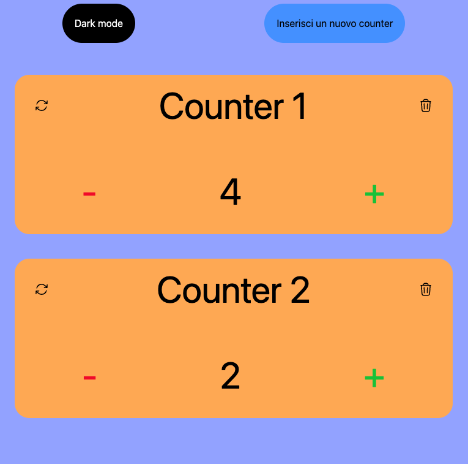
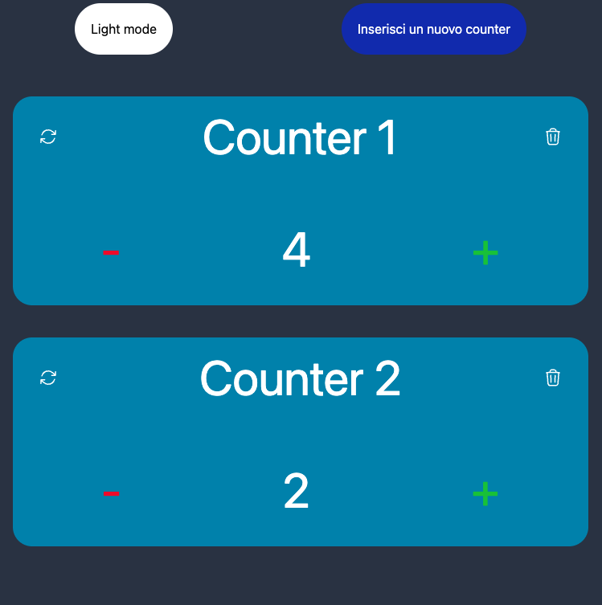

  

  # Multi-Counter Web App

  **Un'applicazione web interattiva e persistente per creare, gestire e monitorare più contatori personalizzati contemporaneamente.**

  [Prova la Demo Live](https://antoniosilvestre.altervista.org) · [Segnala un Bug](https://github.com/silvestreantonio/Counter/issues)

---

## Il Progetto

**Multi-Counter Web App** è una Single Page Application (SPA) sviluppata in **JavaScript Vanilla (ES6+)** e **Tailwind CSS**, progettata per offrire uno strumento rapido, intuitivo e moderno per tenere traccia di conteggi multipli (allenamenti, abitudini quotidiane, punteggi, inventario, ecc.).

L'intera interfaccia dei contatori viene generata dinamicamente tramite **manipolazione pura del DOM**, separando in modo modulare la gestione dello stato, il rendering grafico e la persistenza dei dati nel browser.

### Screenshot

<!-- Salva gli screenshot reali nella cartella assets/img/ con questi nomi -->
| Light Mode | Dark Mode |
| :---: | :---: |
|  |  |

---

## Funzionalità

- **Creazione Multi-Istanza Dinamica**: Aggiungi infiniti contatori personalizzati assegnando a ciascuno un titolo specifico tramite pannello a scomparsa.
- **Validazione degli Input**: Controllo automatico per impedire la creazione di contatori con titoli vuoti o composti da soli spazi (`trim()`).
- **Controllo Completo del Valore**:
  - **Incremento (`+`)** e **Decremento (`-`)** con blocco dei valori negativi (il contatore non scende sotto lo `0`).
  - **Reset Rapido**: Riporta istantaneamente a `0` il singolo contatore.
  - **Eliminazione Definitiva**: Rimuove il contatore sia dal DOM che dallo storage.
- **Persistenza Dati (`localStorage`)**: Ogni modifica (creazione, aggiornamento del valore, reset o rimozione) viene sincronizzata in tempo reale con il `localStorage`, mantenendo tutti i contatori intatti anche al ricaricamento o alla chiusura del browser.
- **Dark Mode Persistente**: Cambio tema fluido tra modalità Chiara e Scura con salvataggio automatico della preferenza dell'utente nel `localStorage`.
- **Design Responsive**: Interfaccia adattabile a dispositivi desktop, tablet e smartphone con barra di navigazione sticky.

---

## Tecnologie Utilizzate

- **HTML5** — Struttura semantica della pagina (`<nav>`, favicon e collegamenti modulari).
- **Tailwind CSS** — Styling utility-first, transizioni e supporto nativo al tema `dark`.
- **JavaScript (ES6+)** — Manipolazione dinamica del DOM, Event Delegation, programmazione modulare e gestione `localStorage`.

---

## Struttura del Progetto

    Counter/
    ├── assets/
    │   ├── css/
    │   │   └── output.css          # Foglio di stile Tailwind CSS compilato
    │   ├── img/
    │   │   ├── logo.png            # Logo / Favicon dell'applicazione
    │   │   ├── dark-mode.png
    │   │   └── light-mode.png
    │   └── js/
    │       ├── counter.js          # Logica CRUD, manipolazione DOM e sincronizzazione localStorage
    │       └── darkMode.js         # Gestione e persistenza del tema Light/Dark
    ├── .gitignore                  # Esclusione di node_modules e file temporanei
    ├── index.html                  # Entry point dell'applicazione
    └── README.md                   # Documentazione del progetto

---

## Utilizzo

Non è necessaria alcuna installazione: l'applicazione è già online e pronta all'uso direttamente dal browser!

**[Apri Multi-Counter Web App](https://antoniosilvestre.altervista.org)**

*(Opzionale: per ispezionare o modificare il codice sorgente in locale, clona il repository e apri `index.html` nel browser.)*

---

## Autore

**Antonio Silvestre**

- GitHub: [@silvestreantonio](https://github.com/silvestreantonio)
- LinkedIn: [Antonio Silvestre](https://www.linkedin.com/in/silvestreantonio99)

---

  Progetto realizzato durante il master in AI e Agenti AI per il Business di start2impact

